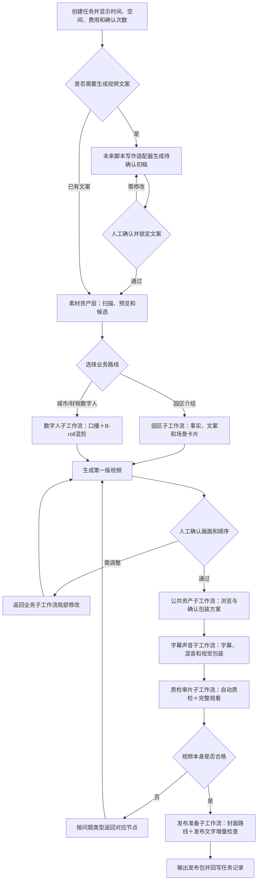

# 视频生产总工作流设计

日期：2026-08-12

修订日期：2026-08-13

状态：设计定稿；进入分期开发，未实现能力仍以各阶段验收为准

运营入口：近期由 Codex 或 WorkBuddy 按流程执行，暂不开发独立操作界面

## 1. 文档定位

本文是视频生产系统的唯一总控入口，只保留所有视频都需要遵守的主链、门禁、数据契约、子工作流路由和实施顺序。

详细规则拆入子工作流，Agent 每次只读取当前任务需要的文档，避免重复加载整套设计、占用上下文和 Token。

普通团队成员不直接阅读全部技术规格，日常操作入口为[视频生产工作流用户使用手册](../../user-guide/video-production-user-guide.md)。手册用流程图和大白话说明输入、四个人工确认点、数字人＋B-roll混剪、外部封面工具、返工和交付。

## 2. 子工作流装配表

| 子工作流 | 何时加载 | 负责内容 |
| --- | --- | --- |
| [渐进式素材资产层技术设计](./2026-08-13-large-media-progressive-asset-workflow-design.md) | 任务包含本地/NAS原始素材、素材盘点或长期素材库 | 大文件扫描、素材 ID、代理、片段、音频分析、断点恢复 |
| [园区介绍视频子工作流](./2026-08-13-park-video-subworkflow-design.md) | 制作园区介绍、厂房招商、投资环境视频 | 园区素材检查表、文案支撑核验、真实场景与补拍 |
| [数字人视频子工作流](./2026-08-13-digital-human-video-subworkflow-design.md) | 制作城市矩阵或财税数字人视频 | 数字人底片、文案对齐、B-roll规则和专项事实核验 |
| [字幕与声音包装子工作流](./2026-08-13-subtitle-audio-packaging-subworkflow-design.md) | 画面与顺序接近锁定，需要字幕、声音、BGM和包装 | 累积字幕、重点词、原素材声音、混音和包装 |
| [公共包装资产与AI音色库子工作流](./2026-08-13-shared-packaging-assets-voice-library-subworkflow-design.md) | 需要浏览、推荐、选择或扩充音色、BGM、音效、字幕、文字卡、贴纸和花字 | 团队核心资产、本地扩充、试听预览、包装方案和授权 |
| [质检、审片与交付子工作流](./2026-08-13-quality-review-delivery-subworkflow-design.md) | 生成第一版、候选版或正式交付 | 版本门禁、自动质检、完整审片、返工和交付归档 |
| [发布准备与合规检查子工作流](./2026-08-13-publishing-preparation-compliance-subworkflow-design.md) | 成片通过完整审片，准备发布 | 封面、标题简介、敏感表达、隐私复查和发布包 |

加载规则：

- 所有任务先读本文。
- 再加载一份业务路线子工作流：园区或数字人。
- 需要处理原始素材时加载素材资产层。
- 任务需要选择配音或包装资产时加载公共包装资产子工作流。
- 进入包装阶段才加载字幕与声音子工作流。
- 进入审片和交付阶段才加载质检交付子工作流。
- 成片确认后、准备发布时才加载发布准备子工作流。
- 不因单个问题加载所有子工作流；子工作流之间通过统一数据契约组装。

## 3. 覆盖范围

当前覆盖三类视频：

1. 园区介绍视频。
2. 城市矩阵数字人视频。
3. 财税数字人视频。

三类视频共用任务管理、素材资产、第一版视频、画面锁定、字幕声音包装、质检、版本和归档机制；素材准备、事实核验和配图边界按业务路线分开。

## 4. 统一端到端主链

```text
创建视频任务
→ 确认业务路线、用途、发布平台、目标时长范围和交付方式
→ 注册本地硬盘/NAS素材并快速盘点
→ 优先分析当前项目需要的素材
→ 整理系统推荐素材、用户指定素材与缺口
→ 生成或核验最终文案
→ 根据文案或配音结果锁定正式时长
→ 需要AI配音时浏览、试听并确认音色
→ 建立场景卡片并匹配素材
→ 生成第一版视频
→ 调整画面、节奏和顺序
→ 用户确认画面和顺序
→ 浏览资产并确认BGM、音效、字幕、文字卡、贴纸和花字包装方案
→ 制作字幕、声音和视觉包装
→ 自动质检并完整观看候选成片
→ 按问题类型返回对应节点
→ 选择使用自有封面生成器或由本项目生成封面
→ 复用质检报告并检查新增封面与发布文字
→ 正式交付发布包并回写素材使用记录
```

核心原则：原片由本机工具直接处理，Agent 只读取结构化索引、文本、缩略图、低清代理、标签、时间码和摘要；不把完整大视频或长日志送入模型上下文。

### 4.1 总工作流流程图



## 5. 创建任务门禁

每次创建任务必须确认：

- 业务路线：园区介绍、城市矩阵数字人或财税数字人。
- 视频用途和发布平台。当前默认记录为视频号、抖音和小红书，并共用同一份 9:16 成片，不增加平台适配和派生版本；其他渠道只在确有任务时记录。
- 目标时长范围，或选择由系统根据用途、平台和素材推荐；创建任务时不要求精确锁死时长。
- 素材位于本机、NAS或两者。
- 交付方式：只要成片，或成片加可编辑素材包。
- 是否存在最终文案、数字人底片、配音和来源资料。
- 是否存在必须真实呈现、不得使用替代画面的对象。

数字人路线必须同时提供禅镜最终数字人 MP4 和禅镜实际使用的最终口播文案。缺少任一项，不进入正式剪辑。

来源资料不固定必填；检测到政策、案例、关键数据、排名、项目金额或其他高风险事实时，再要求补充或协助检索核验。

时长采用两阶段确认：

1. 创建任务时记录目标范围，例如约60秒、1—2分钟或由系统推荐。
2. 文案、数字人口播或配音形成后，系统报告预计实际时长，并给出保留、压缩或拆分建议；用户在进入正式分镜前锁定时长目标。

## 6. 统一里程碑

对业务人员统一显示：

1. 创建任务。
2. 开始前检查。
3. 整理出可以使用的素材，包括系统推荐和用户指定素材。
4. 确认文案和每一段使用的画面。
5. 需要AI配音时，试听并确认音色。
6. 生成第一版视频。
7. 画面与节奏调整。
8. 确认画面和顺序。
9. 浏览并确认BGM、音效、字幕、文字卡、贴纸和花字方案。
10. 制作字幕、声音和画面效果。
11. 检查并完整观看成片。
12. 交付文件并保存任务记录。

标准任务只设置四个人工门禁：文案锁定、画面和顺序锁定、包装方案确认、使用人完整观看并确认可发布。其余里程碑默认自动推进；只有输入缺失、空间不足、素材低置信度、隐私风险、真实性冲突、首次使用新音色或技术异常时才暂停询问。部门负责人承担最终业务审核，但单条任务从创建到交付由实际使用人负责。

“确认画面和顺序”是正式门禁。通过后才集中制作字幕、声音和包装，避免素材和镜头仍频繁变化时重复返工。包装即使已有团队默认方案，也必须向使用人展示简明预览并确认一次，不静默通过。

每个里程碑记录输入、执行动作、阶段产物、用户确认、完成标准、异常处理和返回节点。

## 7. 统一数据契约

子工作流通过以下对象组装：

| 对象 | 作用 |
| --- | --- |
| `task.json` | 路线、里程碑、状态、交付方式和下一步 |
| `asset_id` | 不依赖固定盘符的素材身份 |
| `segment_id` | 原视频中可用时间段的非破坏性引用 |
| `script` | 已确认或待核验的最终文案 |
| `script_request` | 提交给未来视频脚本写作适配器的路线、用途、时长、素材摘要、事实约束、语气和CTA |
| `script_result` | 写作适配器返回的文案、场景意图、事实声明、来源引用、警告和提供方版本 |
| `scene_cards` | 旁白、时间、素材、来源、替代和确认状态 |
| `asset_decision` | 用户指定或系统推荐素材的质量、匹配、风险、建议和最终决定 |
| `audio_policy` | 原素材声音的保留、静音、压低、清理或替换决定 |
| `subtitle_plan` | 完整语义句、显示分组、累积方式、重点词和安全区 |
| `packaging_plan` | 音色、BGM、音效、字幕模板、文字卡、贴纸、花字、品牌资产及确认状态 |
| `render_snapshot` | 文案、分镜、素材指纹、时间码和包装配置快照 |
| `qa_report` | 自动检查、人工审片问题、返回节点和处理状态 |
| `publish_plan` | 封面、标题、简介、标签、敏感表达与发布前检查状态 |

任何子工作流不得绕过这些契约直接把一次性判断写死进最终渲染命令。

质检审片只判断视频本身是否制作合格；发布准备读取 `qa_report`，只处理封面路线、发布标题简介及其新增的敏感表达、事实和隐私风险。两者不得重复执行相同的视频技术扫描或重复要求用户确认已经确认过的风险。

### 7.1 视频脚本写作 Skill 适配口（后续待办）

未来允许调用或嵌入视频脚本写作 Skill，但总工作流不绑定具体 Skill 名称、Agent 或模型。统一适配器只接收 `script_request`，只返回 `script_result`；人工撰写、内嵌 Skill 和外部 Agent 调用都必须遵守同一契约。

- 适配器只读取结构化素材摘要、场景标签、事实资料和用户要求，不读取或上传完整 10GB 原片。
- 园区“无文案”入口可以直接调用适配器；用户已有文案时仍先使用用户文案并执行核验。
- 数字人路线中，适配器位于禅镜生成之前。进入剪辑时仍强制要求最终数字人 MP4 和禅镜实际使用的最终口播文案，避免文案、口型和时间戳不一致。
- Skill 输出永远是待确认文案，不得自动越过文案锁定门禁。
- Skill 不可用、超时或输出不合格时，回退到人工提供/修改文案，不阻塞素材建库和其他前置工作。
- 该适配器列入后续开发待办，不作为 P0 素材数据底座的依赖。

### 7.2 每类数据的唯一主账本

“唯一事实源”不是要求所有内容塞进一个文件，而是同一类事实只能有一个最终准确信息源：

- 素材身份、位置、分析结果和任务状态以 SQLite 为主账本。
- `task.json`、`scene_cards`、`plan.json` 等是供现有脚本消费的导出物，不得反向覆盖主账本。
- 每个已锁定成片版本以不可变的 `render_snapshot` 为准。
- 人工确认高于自动判断；自动重算不得静默覆盖人工结论。
- 主账本与导出物不一致时停止渲染并重新导出，不猜测采用哪一份。

### 7.3 成功指标、时间与成本

- 项目成功：公共素材和包装资产成熟后，普通团队成员能够低门槛独立使用，每天投入 2 小时完成 4 条标准短视频，并且不因技术故障反复返工。
- 单条视频成功：标准短视频约 30 分钟达到可发布条件；较长视频或更高质量要求按任务估算延长。可发布条件包含画面、字幕、声音、包装、自动质检和使用人完整观看，不只代表生成 MP4。
- 同时统计人工操作时间和总完成时间。前者只计算使用人的操作、选择、修改和审片时间；后者计算从任务开始到可发布的全部墙钟时间，包括机器分析和渲染等待。
- 任务开始时展示预计完成时间、预计新增磁盘、预计 API 费用和预计人工确认次数；后台保存预计值、实际值和偏差，逐步用真实任务校准。详细计算依据仅在用户展开时显示。

### 7.4 效率与 Token 门禁

- 每次只加载总控文档和当前阶段需要的子工作流。
- 文件扫描、ffprobe、Whisper、FFmpeg和质量检测在本机执行；Agent只读取结构化摘要和失败片段。
- 视觉理解优先使用缩略图、接触表和低清代理，不把原始大视频逐帧送入模型。
- 已完成的素材分析按指纹和版本缓存；没有变化就不重复识别。
- 深度分析只围绕当前文案和候选素材，不先扫描完整长期素材库的全部内容。
- 长日志写入文件，Agent默认读取退出码、进度、警告和错误摘要。
- 分镜和渲染使用素材 ID 与时间码，避免复制原片和生成大量重复中间文件。
- 任务中默认只展示3—5个相关资产或2—3套包装方案；完整资产库通过本地目录浏览，不把全库清单塞入对话上下文。
- 同一时间只运行一个 FFmpeg 渲染、Whisper、代理生成或其他重型任务。创建第二条任务时明确提示“请勿同时剪辑两条视频”；允许在重任务运行时浏览素材、编辑文案等轻量操作。

### 7.5 工序、工具与产物

| 工序 | 本机工具或能力 | 结构化产物 |
| --- | --- | --- |
| 文件盘点 | 文件扫描、快速指纹 | 素材清单与扫描状态 |
| 技术探测 | ffprobe、图片参数读取 | 时长、画幅、编码、音轨和异常 |
| 轻量预览 | FFmpeg抽帧、接触表、按需代理 | 缩略图与代理索引 |
| 音频分析 | VAD、粗转写、响度和异常检测 | 人声区间、声音摘要和风险标签 |
| 场景与质检 | 场景切分、图像质量、OCR、视觉识别 | 非破坏性片段、标签、三级质量结论和置信度 |
| 基础画面校正 | FFmpeg滤镜、色彩与曝光检查 | 提亮、压高光、白平衡、对比度和色彩转换参数 |
| 文案核验 | 业务规则、来源核验、素材支撑映射 | 最终文案与逐句映射 |
| 时间对齐 | Whisper词级时间戳、原文校正 | 词级时间线和错读报告 |
| 分镜规划 | 场景卡片、素材候选和人工确认 | 场景卡片与素材选择 |
| 第一版视频 | FFmpeg、现有plan/compile/render能力 | rough版本 |
| 字幕与声音 | ASS、FFmpeg音频滤镜 | 字幕计划、混音策略和候选版 |
| 质检交付 | ffprobe、规则检查、完整人工审片 | QA报告、正式成片和交付包 |

## 8. 原始素材声音的统一处理位置

原始视频中有拍摄者说话、设备声、风声、车辆声或其他环境声，不直接判为不可用。

处理链：

```text
素材入库
→ 检测是否存在音轨
→ VAD 判断是否有人声
→ 对人声生成低成本转写和时间段
→ 检测静音、削波、底噪和异常响度
→ 标记声音类型与风险
→ 在场景卡片中确定 audio_policy
→ 混音阶段执行保留、静音、压低、清理或替换
```

技术探测和识别属于素材资产层；是否使用原声属于业务分镜；真正的降噪、静音、压低和混音属于字幕与声音包装子工作流。

第一阶段要求识别人声区间、粗转写和明显音频异常，不承诺一次识别所有复杂噪声来源，也不默认启用说话人身份识别。

## 9. 累积字幕的统一处理位置

目标字幕模式：一个完整语义句可以由几句话或短语组成；短语按口播时间一句一句出现，已出现内容保留，最后形成完整一句话，再整体退场。

处理链：

```text
最终文案
→ Whisper 词级时间戳
→ 原文校正
→ 完整语义句分组
→ 语义句内短语切分
→ 生成累积显示事件
→ 手机安全区与最大行数检查
→ 画面锁定后用 ASS 烧录
```

文案与时间戳对齐在数字人或配音阶段完成；字幕语义分组和累积事件由字幕子工作流生成；最终渲染仍由 FFmpeg/ASS 完成。

累积字幕必须避免无限堆叠：达到预设行数、字数或安全区上限时，以完整语义句为单位换屏。不得切断数字、量词、园区名、城市名、企业名、税务术语和重点词。

## 10. 真实性与替代边界

用户可以指定希望使用的素材，但“用户指定”表示优先评估，不等于无条件进入成片。系统仍需检查文件、清晰度、稳定性、画幅、文案匹配、事实归属、授权、隐私、声音、重复和节奏，并给出：推荐使用、处理后可用、不建议使用或不可使用。

用户在知悉非阻断风险后仍坚持使用的，记录人工决定和影响；损坏、无授权、事实错误、严重隐私或明确违规素材不得因用户指定而绕过门禁。

自动推荐第一阶段不建立缺乏样本依据的综合评分。系统只按场景匹配、技术可用、隐私/真实性风险、重复情况和是否需要裁切或提亮依次筛选，并显示推荐理由与警告。普通低置信度素材允许带警告使用；涉及人物身份、园区真实性或明确隐私风险时必须人工确认。

内容分析结果使用“可用 / 警告使用 / 不建议使用”三级结论并附具体原因，不预设未经真实样片验证的统一数值阈值。分析不足时必须升级抽帧密度、缩小分析区间或换方法交叉检查；同一算法原参数重复运行不视为深化分析。

缺失画面的替代优先级：

1. 同一园区、城市、企业或事件的同点位其他镜头。
2. 同一对象的相邻场景。
3. 同一对象的真实图片，通过推拉、平移或局部裁切动态化。
4. 基于真实信息制作地图、参数卡、时间线或政策信息卡。
5. 通用素材或 AI 生成素材只用于概念和气氛表达。

通用或 AI 素材不得冒充真实园区、城市、企业、项目、政策事件、税务稽查或执法现场。

## 11. 版本、返工与交付

统一版本阶段：

```text
rough-v1 → rough-v2 → picture-lock-v1 → candidate-v1 → candidate-v2 → final-v1
```

修改意见必须归类为文案、数字人重制、素材、节奏、字幕、声音、包装或事实问题，并从对应节点重跑，不覆盖历史版本。

文案修改采用依赖关系驱动的最小范围重跑：错字只更新字幕和最终渲染；单句修改只更新该句配音、字幕、对应镜头及后续时间对齐；新增或删除段落才重排受影响位置之后的时间线。素材扫描、无关分析和已确认的无关镜头不重做。由于最终交付是完整 MP4，最后导出仍可能需要重新渲染全片。

新任务默认使用最新规则；已经创建的任务锁定创建时的规则、资产和包装版本。旧任务只有在使用人主动选择升级并看到影响范围后才切换新规则。

“只要成片”至少交付最终 MP4 和成片检查报告。“成片＋后续可编辑文件”当前稳定提供可编辑素材包，不提前承诺剪映原生工程。

## 12. 统一实施路线

### P0：任务框架与素材数据底座

- 固定任务目录、状态、版本和交付选项。
- 实现本地/NAS素材库注册、快速扫描、SQLite索引、技术探测和断点恢复。
- 用真实 10GB 以上素材验证单机顺序处理。
- P0 的成功闭环是扫描、建目录、可搜索、可恢复，不要求紧接着剪出第一条视频，也不得把建库成功等同于 30 分钟出片成功。

### P1：预览选材与可剪素材处理

- 实现缩略图、接触表、按需代理、音频预览和基础音频分析。
- 实现场景片段、图片筛选、候选/拒绝/确认和素材检查表映射。
- 支持用户指定素材进入同一质量与匹配评估，并保存建议和最终决定。
- 建立团队核心包装资产清单、本地扩充目录和资产浏览目录。
- 跑通一条园区视频和一条数字人视频的人工协同第一版。
- 增加代理与原片时间码一致性验证，以及可同时作用于代理预览和最终原片的基础画面校正。

### P2：三类路线接入与质量控制

- 统一场景卡片、素材适配、文案支撑检查和渲染依赖快照。
- 实现累积字幕模式、原素材声音策略、响度和 BGM 处理。
- 实现AI音色推荐、试听、可用性检查，以及BGM、音效、文字卡、贴纸、花字和字幕模板组成的包装方案。
- 建立画面锁定、自动质检、完整审片和返工闭环。
- 建立发布准备与合规检查子工作流，输出封面、标题简介建议、敏感表达检查和发布包，不自动登录或上传平台。

### P3：智能深化与产品化评估

- 增加场景识别、OCR、三级质量结论、重复检测和语义匹配；只在真实样片积累足够后评估是否需要数值阈值。
- 根据真实审片反馈沉淀三类出片方案。
- 实现视频脚本写作适配器，先接园区无文案入口，再评估数字人生成前的脚本调用；保持人工文案回退。
- 只有单机流程稳定且出现并发需求后，才评估中心服务或操作界面。

## 13. 当前不实施

- 多人多机同时写入。
- 同时运行两条重型剪辑任务。
- 中心数据库和消息队列。
- 为全库素材强制生成完整代理。
- 把大视频上传给模型逐帧理解。
- 未验证前承诺剪映原生工程。
- 推翻现有 FFmpeg 引擎或改用 Remotion。

## 14. 首轮验证顺序

1. 使用真实 10GB 以上园区素材验证 P0 扫描、索引和恢复。
2. 对当前项目候选生成预览、片段和基础音频分析。
3. 生成园区第一版视频，验证素材支撑、镜头长度、重复和转场。
4. 选择一条数字人视频验证 MP4、最终文案、词级时间戳和 B-roll 匹配。
5. 制作累积字幕样例并在手机安全区审看。
6. 对含拍摄者说话、环境声和杂音的素材验证声音识别与处理决策。
7. 记录审片问题，按子工作流更新规则，不把单次问题直接升级成全局硬规则。
8. 验证 30 分钟标准任务口径，同时记录人工操作时间和总完成时间。
9. 验证文案局部修改只重跑受影响环节。
10. 验证封面、敏感表达、隐私复查和发布包输出。
