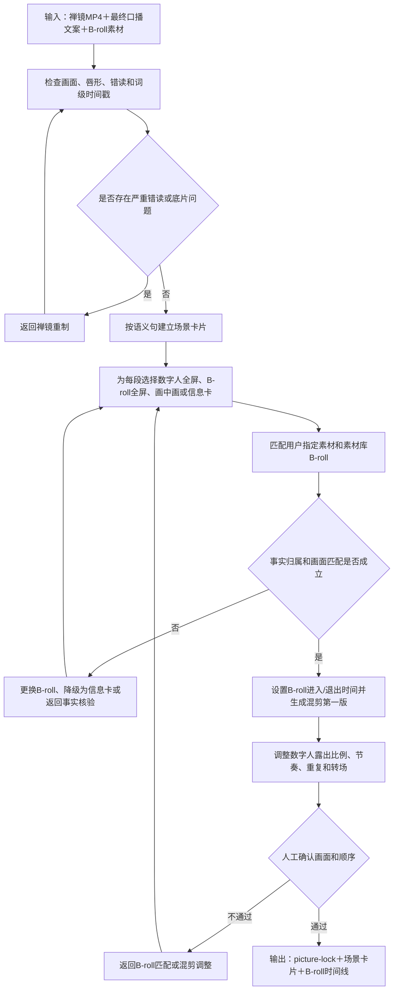

# 数字人视频子工作流设计

父流程：[视频生产总工作流](./2026-08-12-video-production-workflow-design.md)

状态：设计定稿；进入分期开发，待真实样片验证

## 1. 适用范围

用于城市矩阵数字人和财税数字人视频。两类视频共用底片检查、文案时间对齐、场景卡片、第一版视频和画面锁定机制，但使用不同事实核验、素材库、字幕词典和配图边界。

本路线的标准成片不是数字人口播原片直接加字幕，而是以数字人口播和声音时间轴为主线，与 B-roll、图片、地图、政策截图和信息卡混合剪辑。

### 1.1 数字人＋B-roll混剪步骤链

```text
禅镜数字人 MP4＋实际口播文案
→ 检查画面、口播、唇形、错读和词级时间戳
→ 按完整语义句拆分场景卡片
→ 判断每段保留数字人还是插入 B-roll
→ 从用户指定素材、素材库或允许来源匹配 B-roll
→ 设置全屏 B-roll、数字人全屏或画中画形式及进入/退出时间
→ 生成数字人＋B-roll混剪第一版
→ 调整数字人露出比例、B-roll节奏、重复和转场
→ 用户确认画面与顺序
→ 输出 picture-lock、场景卡片和 B-roll 时间线
```

严重错读返回禅镜重制；B-roll 错配返回素材匹配；事实问题返回专项核验；画面锁定后交给字幕与声音包装子工作流。

### 1.2 子工作流流程图



## 2. 强制输入

必须同时提供：

```text
禅镜最终数字人 MP4
＋
禅镜实际使用的最终口播文案
```

缺少任一项，不进入正式剪辑。来源资料按风险条件触发，不固定必填。

未来视频脚本写作 Skill 只能在禅镜生成数字人之前调用。Skill 产出的文案经用户锁定并用于生成数字人后，剪辑流程仍以“最终 MP4＋禅镜实际口播文案”为唯一输入；不得在数字人生成后由 Skill 静默改写文案。

## 3. 数字人底片检查

1. 检查画幅、清晰度、人物裁切、背景、黑帧和唇形。
2. 检查人声音量、噪声、爆音、错读和异常停顿。
3. Whisper 生成词级时间戳，并用最终文案校正识别文本。
4. 检查漏读、重复、城市名、产业名、企业名、税务术语、数字和日期。
5. 严重错读返回禅镜重制；可修复问题进入后期。

## 4. 场景拆分与素材匹配

1. 把最终文案拆为完整语义句和场景卡片。
2. 判断每段使用数字人、真实场景、产业画面、地图、新闻/政策截图或数据卡。
3. 从当前任务素材、长期素材库和允许来源中匹配候选。
4. 用户可指定希望优先使用的素材；系统仍检查技术质量、语义匹配、事实归属、授权、隐私、声音、重复和节奏，并给出专业建议。
5. 系统不计算没有样本依据的综合推荐分数，只显示匹配理由、可用状态和警告；普通低置信度素材可人工采用，身份、事实归属和明确隐私风险必须确认。
6. 对候选视频使用 `segment_id` 和原片时间码，不默认复制原片。
7. 检查城市、企业、项目、事件和时间归属。
8. 找不到真实素材时，使用地图、数据卡或中性概念画面降级，不伪造真实事件。

## 5. 城市矩阵专项规则

- 核验城市名称、区域层级、产业、项目、企业、排名、金额和发布日期。
- 城市实景、园区、企业和项目画面必须归属正确。
- 通用产业素材只能表达产业概念，不得冒充某城市实际项目。
- 场景卡片记录数字人露出比例、B-roll进入和退出时机。

## 6. 财税专项规则

- 核验税种、政策名称、文号、金额、日期、地区、主体和适用条件。
- 案例检查脱敏，事实与观点分开。
- 优先使用政策截图、条款标注、流程图、金额卡和时间线。
- 通用办公、合同、发票和账簿画面只能作为中性说明。
- 禁止使用无关警车、抓捕或执法现场制造误导。
- 政策截图必须在手机端可读，必要时局部放大和重点标注。

## 7. 第一版与画面锁定

生成数字人和 B-roll 第一版，重点检查：

- 数字人露出比例是否合理。
- B-roll进入和退出是否贴合语义。
- 是否存在镜头过长、同源重复和转场生硬。
- 数据、政策和截图是否可读且归属正确。

支持的混剪形态包括数字人全屏、B-roll 全屏覆盖但保留数字人口播声音、数字人和 B-roll 画中画、地图/政策截图/信息卡覆盖，以及 B-roll 结束后返回数字人。每张场景卡片必须明确混剪形态和进入、退出时间。

用户确认画面和顺序后，才进入字幕与声音包装。字幕以最终口播文案为准，Whisper主要提供时间戳。

AI音色用于需要重新配音、补录旁白或其他非禅镜配音场景时，按照[公共包装资产与AI音色库子工作流](./2026-08-13-shared-packaging-assets-voice-library-subworkflow-design.md)浏览、试听和确认；不擅自替换已确认的禅镜原声。

## 8. 完成标准

- MP4与最终口播文案已完成时间对齐。
- 高风险事实已核验或明确标记处理边界。
- 场景卡片中的素材归属、替代和确认状态完整。
- 第一版通过画面与顺序确认门禁。
