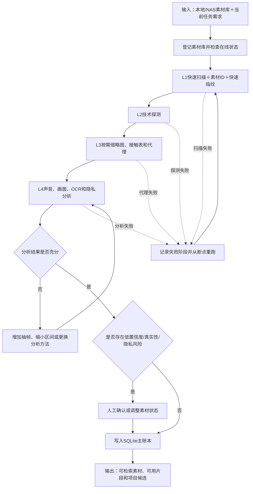

# 渐进式素材资产层技术设计

日期：2026-08-13

父流程：[视频生产总工作流](./2026-08-12-video-production-workflow-design.md)

状态：设计定稿；进入 P0 开发，未实现能力仍以分期验收为准

适用范围：项目介绍视频、城市矩阵数字人视频、财税数字人视频，以及后续共享同一素材底座的视频任务。本文只负责素材资产与渐进分析，不单独代表完整视频生产工作流。

## 1. 背景与目标

现有工作流适合以单条数字人口播视频、文案和少量 B-roll 为输入，通过 `plan / compile / make-ass / render-mix` 完成出片。现实生产中会同时出现两类大素材场景：

1. 单个项目一次导入 10—50GB 视频和图片，完成出片后归档。
2. 长期积累数百GB素材，并在后续多个项目中持续检索和复用。

素材既可能位于本机硬盘，也可能位于 NAS 或局域网盘。第一阶段按单机、顺序执行设计，不支持多人同时写入。首次导入采用渐进式建库：先快速盘点并允许开始工作，再按当前任务优先级补做预览、场景切分、质检和内容识别。

目标：

- Agent 不读取或上传完整大视频，只处理文件清单、元数据、缩略图、代理、标签、音频摘要、字幕和时间码。
- 原片不默认复制、不破坏性切割；最终渲染由 FFmpeg 回读原始高清素材。
- 同时支持单项目大批素材和长期素材资产库。
- 素材移动、盘符变化、NAS 离线或进程中断后，任务可以识别状态并恢复。
- 保留现有字幕和 FFmpeg 成片能力，通过适配层逐步接入。

### 1.1 子工作流步骤链

```text
登记本地硬盘或 NAS 素材库
→ L1 快速扫描并建立素材 ID
→ L2 技术探测和异常标记
→ L3 按需生成缩略图、接触表和代理
→ L4 对当前候选做声音、画面和隐私分析
→ 生成“可用 / 警告使用 / 不建议使用”结论
→ 条件式人工确认低置信度、真实性和隐私风险
→ 输出可检索素材、可用片段和项目候选
```

输入是素材库位置和当前任务需求；输出是 SQLite 主账本中的素材、分析、片段和候选记录。扫描、探测或分析失败时只重跑失败阶段，不影响已经完成的前置结果。

### 1.2 子工作流流程图



## 2. 已确认约束

| 约束 | 已确认选择 |
| --- | --- |
| 业务场景 | 单项目大批素材与长期素材库都要兼容 |
| 存储位置 | 本机硬盘与 NAS/局域网盘都要兼容 |
| 第一阶段并发 | 单机顺序处理 |
| 首次导入体验 | 渐进式建库，快速盘点后即可开始 |
| 成片引擎 | 保留现有 FFmpeg 路线，不改用 Remotion |
| 原片策略 | 原片只读，任务引用素材，不默认复制原片 |
| 用户入口 | 继续由 Codex 或 WorkBuddy 编排，暂不开发独立界面 |

## 3. 方案选择

采用分层渐进式素材架构：以 SQLite 保存素材身份、位置、分析状态、标签和可用片段。首次只做快速扫描，后续按需生成缩略图、代理、场景片段和视觉分析。项目任务仅保存素材引用和剪辑决策，最终由 FFmpeg 读取原片。

不采用以下方案：

- 仅为 `public/library` 增加扫描补丁：不能可靠解决跨盘符定位、去重、断点恢复和跨项目复用。
- 首轮建设完整媒体资产管理平台：中心数据库、后台服务、多机任务队列、权限系统和界面超出当前单机需求。

## 4. 总体架构

```text
本地硬盘 / NAS 原始素材
        ↓
素材资产层
统一扫描、素材 ID、文件指纹、库位置、SQLite 索引
        ↓
渐进分析层
技术参数 → 缩略图 → 低清代理 → 场景片段 → 质检/OCR/视觉标签
        ↓
项目任务层
本次文案、候选素材、分镜、用户确认、版本与断点状态
        ↓
现有剪辑渲染层
plan / compile / make-ass / FFmpeg 回读原片 → 成片
```

层级职责：

- 素材资产层：注册素材库、建立稳定 `asset_id`，保存相对路径、物理副本、快速指纹和技术参数。
- 渐进分析层：独立处理技术探测、缩略图、接触表、代理、场景切分、质检、OCR 和视觉标签。
- 项目任务层：保存本次候选、拒绝、选用、替代、人工确认、分镜、版本和里程碑。
- 剪辑渲染层：保留现有脚本，通过适配器把 `asset_id + segment_id` 解析为文件路径和时间码。

## 5. 素材身份与位置

数据库不能把绝对路径作为素材唯一身份。每个素材库登记稳定 `library_id`，运行配置保存当前挂载位置。

```json
{
  "library_id": "park-local-01",
  "name": "项目本地素材库",
  "kind": "local",
  "mount": "D:\\园区素材"
}
```

素材记录使用：

```text
library_id = park-local-01
relative_path = 厂房/a.mp4
asset_id = ast_xxx
quick_fingerprint = 文件大小 + 首部与尾部分块哈希
```

指纹与寻址规则：

- 首次扫描不强制对几十GB文件计算完整哈希。
- 快速指纹用于去重候选和文件移动重连。
- 快速指纹只表示“疑似同一素材”，不得据此自动合并、覆盖或删除。准备确认同一素材、跨库迁移或出现冲突时必须补算完整 SHA-256；完整哈希不同即保留为两个素材。
- 疑似重复、跨库迁移校验、长期归档或冲突时，后台补算完整 SHA-256。
- 文件修改时间用于发现变化，但不单独作为身份依据。
- 同一素材的本地和 NAS 副本共用一个 `asset_id`，分别记录位置。
- 解析路径时优先在线的本地副本，其次通过读取检查的 NAS 副本。
- 没有在线原片时仍可浏览索引和代理，但最终渲染等待素材库上线。

## 6. 渐进式处理阶段

| 阶段 | 自动动作 | 主要产物 | 是否阻塞开始工作 |
| --- | --- | --- | --- |
| L0 注册 | 登记素材库并检查在线状态 | `library_id`、根目录映射 | 否 |
| L1 快速盘点 | 遍历文件、记录基础属性、计算快速指纹 | 素材清单、去重候选、扫描进度 | 仅等待本阶段 |
| L2 技术探测 | ffprobe 和图片参数读取 | 技术参数、损坏和不兼容标记 | 否 |
| L3 轻量预览 | 缩略图、接触表、按需代理和音频预览 | 可快速审看的轻量缓存 | 按需优先 |
| L4 内容分析 | 场景切分、画面质量、VAD人声区间、粗转写、明显音频异常、OCR和视觉标签 | `segment_id`、声音摘要、标签、质量分和置信度 | 否 |
| L5 项目深化 | 按当前文案密集抽帧、语义匹配和人工确认 | 项目候选镜头与分镜 | 只阻塞相关镜头 |

快速可用标准：

- L1 完成后可按文件、素材库和目录搜索。
- L2 完成后可按时长、画幅、分辨率、编码和损坏状态筛选。
- 当前项目所需候选完成必要的 L3/L4 后才进入自动分镜。
- 全库未完成深度分析不阻塞当前项目出片。

调度顺序为：当前项目、已进入候选池的素材、短小且可快速完成的文件、长期素材库后台补齐。系统不对全库平均用力。

内容分析不预设未经样片验证的统一质量分数，先输出“可用 / 警告使用 / 不建议使用”和具体原因。普通低置信度素材可由使用人在知情后采用；涉及身份、真实性或明确隐私风险时必须人工确认。需要深化时依次增加抽帧密度、缩小分析区间或更换分析方法，禁止把同一算法原参数重复执行当作再次分析。

代理与原片必须共享同一素材时间基准。生成代理时统一记录旋转、可变帧率、时间基准、起始时间、音画偏移和色彩空间；剪辑点始终保存为原片时间码，不保存为代理帧号。最终渲染前抽查代理时间点与原片对应画面，出现偏差时阻止渲染并重建代理。

基础画面校正采用非破坏性参数，支持暗画面提亮、过曝压低、对比度、白平衡、饱和度和 HDR 到普通屏幕色彩转换。代理预览和最终原片必须使用同一组校正参数，原片文件本身不被修改。

缓存策略：

- 图片默认先生成缩略图；视频默认先生成接触表。
- 仅为需要连续审看、视觉识别或进入候选池的视频生成低码率代理。
- 所有预览都是可删除、可重建缓存，并设置独立容量上限。
- 索引、人工确认、任务决策和正式成片不得作为缓存自动删除。

### 6.1 原始素材音频分析边界

素材资产层负责识别“有什么声音”，不负责直接决定成片中“该怎么使用”。

第一阶段分析：

- 是否存在音轨及其基础参数。
- VAD检测人声出现区间。
- 对人声区间生成低成本粗转写，辅助判断拍摄者闲聊、有效同期声和隐私风险。
- 检测明显静音、削波、音量突跳和持续底噪。
- 保存分析置信度、工具版本和可人工修正的声音标签。

不在第一阶段承诺：复杂环境下精确区分所有噪声来源、多人重叠语音完全识别或自动判断具体说话人身份。

素材资产层把分析结果交给业务场景卡片；项目或数字人子工作流决定 `keep / mute / duck / clean / replace`，再由[字幕与声音包装子工作流](./2026-08-13-subtitle-audio-packaging-subworkflow-design.md)执行。

## 7. 目录结构

```text
视频自动化剪辑/
├─ config/
│  └─ media-libraries.json
├─ runtime/
│  └─ media-catalog/
│     ├─ catalog.sqlite
│     ├─ backups/
│     └─ cache/{thumbnails,contact-sheets,proxies,audio-previews}/
├─ projects/
│  └─ <task-id>/
│     ├─ task.json
│     ├─ inputs/
│     ├─ selections.json
│     ├─ storyboard.json
│     ├─ versions/
│     ├─ reports/
│     └─ deliverables/
├─ public/
└─ out/
```

大原片继续位于已注册的本地或 NAS 素材库中。`runtime/media-catalog`、项目中间版本和大体量交付物按实际内容配置 Git 忽略；设计文档、数据契约和数据库迁移代码进入版本管理。

## 8. SQLite 核心数据模型

| 实体 | 作用 |
| --- | --- |
| `libraries` | 本地盘/NAS素材库、挂载位置和在线状态 |
| `assets` | 稳定素材身份、类型、指纹和基础属性 |
| `asset_locations` | 同一素材的一个或多个物理位置 |
| `analysis_runs` | 画面/音频分析阶段、进度、失败原因、重试次数和算法版本 |
| `segments` | 原视频可用时间段及片段级质量信息 |
| `tags` / `asset_tags` | 场景、项目、城市、授权、真实性和置信度 |
| `tasks` | 单条视频任务、路线和当前里程碑 |
| `task_assets` | 本次候选、选用、拒绝和替代素材 |
| `decisions` | 用户确认、人工纠正、原因和时间 |
| `renders` | rough、picture-lock、candidate、final 版本及依赖快照 |

人工确认高于自动识别，自动更新不得静默覆盖人工判断。长期资产事实与单次任务偏好分开保存。每个分析结果保存算法或规则版本；版本变化后可标记 `stale` 并重算。

同一类事实只有一个主账本：素材身份、位置、分析、任务状态和人工决定以 SQLite 为准；JSON 文件只作为现有剪辑脚本的导出物。主账本与导出物不一致时重新导出，不允许任意选择一份继续渲染。

## 9. 项目任务与版本

每条视频任务建立独立目录和状态文件。任务只引用素材，不复制大原片。状态至少包括当前里程碑、已完成阶段、运行任务、等待条件、失败摘要、待确认事项、当前版本和下一步。

版本阶段沿用：`rough-v1`、`rough-v2`、`picture-lock-v1`、`candidate-v1`、`candidate-v2`、`final-v1`。

每次渲染开始前锁定文案版本、分镜版本、素材和片段 ID、原片指纹、时间码，以及字幕、声音和品牌配置版本。素材库后续更新不得改变已锁定版本。

## 10. 断点恢复与任务状态

耗时动作拆成：扫描 → 技术探测 → 缩略图 → 代理 → 场景切分 → 内容识别 → 渲染。

每项记录输入和依赖、输出位置、状态、开始/完成/心跳时间、重试次数、退出码、错误摘要和工具版本。状态为 `pending / running / completed / failed / interrupted / stale`。

恢复规则：

- Agent 退出或电脑重启后，只续跑未完成任务。
- 只有进程确实不存在且心跳过期，才把 `running` 转为 `interrupted`。
- 长视频的抽帧和识别按时间区间分块，已完成区间不重跑。
- 已成功的前置分析不会因为最终渲染失败而重做。
- FFmpeg 单次成片不能安全从任意帧续接；最终渲染失败时只重跑该渲染版本。

失败分类：临时进程错误有限重试；文件损坏、编码不支持、权限不足、NAS 离线和磁盘不足不盲目重试；输入指纹变化时把依赖结果标记为 `stale`。

## 11. 资源与日志控制

- 第一阶段同一时间只运行一个重型任务。
- 创建第二条剪辑任务时直接提示用户不要同时剪辑两条视频；重任务运行期间仍允许素材浏览、文案编辑等轻量操作。
- FFmpeg、ffprobe、Whisper 等使用受控本地进程执行，设置绝对工作目录、硬超时、输出字节上限和唯一终态。
- 完整日志写入运行日志；Agent 默认只读取进度、退出码和错误摘要，避免 Token 浪费。
- 开始任务前估算输出与缓存空间。
- 空间不足时只自动清理可重建缓存，不删除原片、用户输入、人工确认、索引或正式成片。
- 每周执行一次空间检查，磁盘剩余低于 20% 时立即提醒。只允许自动清理可重建的缩略图、代理、临时文件和失败渲染；完成任务的中间版本必须列出预计释放空间并经使用人确认后清理。
- 正式渲染依赖 NAS 时，开始前检查在线状态和连续读取能力。

## 12. 与现有流水线的接入

第一阶段采用旁路接入：

```text
现有：public/library → compile-plan → plan.json → render-mix

新增：素材目录 → catalog.sqlite → 项目候选清单
                                  ↓ 适配器
                            兼容 plan.json
                                  ↓
                         make-ass / render-mix
```

兼容原则：保留 `make-ass`、`render-mix` 和 FFmpeg 成片路径；适配器解析素材与片段 ID；`public/library` 注册为首个兼容素材库；旧 `manifest.json` 可导入为初始标签；旧任务不强制迁移。至少完成一条项目视频和一条数字人视频验证后，再决定是否让 `compile-plan` 直接读取数据库。

## 13. 实施分期

### P0：数据底座

实施素材库注册、SQLite 与版本化迁移、快速扫描、快速指纹、移动重连、ffprobe/图片技术探测、中断恢复、日志摘要和基础磁盘检查。

完成标准：

- 真实 10—50GB 混合目录可快速盘点。
- 扫描中断后继续执行，不重复已完成项。
- 换盘符后只更新挂载位置即可恢复引用。
- NAS 离线状态清晰，不误判素材已删除。

### P1：可视与可选

实施图片缩略图、视频接触表、按需代理、音频预览、VAD人声区间、粗转写、明显音频异常、项目任务目录、候选/拒绝/确认状态，以及缓存容量限制和安全清理。

完成标准：不打开原始大视频即可快速浏览和筛选；缓存清理后可以重建；当前项目选择不污染长期资产事实。

### P2：剪辑接入

实施非破坏性片段时间码、`selections.json`、统一场景卡片、素材 ID 到现有 `plan.json` 的适配器、渲染前检查和版本依赖快照。

完成标准：一条真实项目视频和一条真实数字人视频能够从素材 ID 生成第一版视频；现有字幕和 FFmpeg 渲染结果不回归；本地/NAS双副本能正确择优。

### P3：智能深化

实施场景切分、模糊/抖动/曝光/重复检测、OCR、视觉标签、文案语义匹配、项目检查表映射和低置信度确认。

完成标准：当前项目所需素材可自动形成带依据、置信度和质量信息的候选池；人工纠正不被后续自动识别覆盖；深度分析不阻塞全库使用。

## 14. 首轮明确不实施

- 独立网页或桌面界面。
- 多人、多机同时写入数据库。
- 中心服务器和消息队列。
- 为所有原片生成完整代理。
- 一次性迁移并重分析全部历史素材。
- 复杂向量数据库。
- 剪映原生工程生成。
- 重写现有 FFmpeg 成片引擎。

## 15. 验证与测试

P0 必测：

1. 包含视频、图片和非媒体文件的 10—50GB 真实目录。
2. 扫描中断、Agent 退出和电脑重启后的续跑。
3. 文件改名、目录移动和盘符变化后的重连。
4. NAS 离线、恢复和重新挂载。
5. 同一素材在本地和 NAS 的双副本识别。
6. 损坏视频、超大图片、异常编码、中文路径和长路径。
7. 数据库备份和迁移失败回滚。
8. 扫描期间内存不随素材总字节数线性增长。

`catalog.sqlite` 备份的是素材编号、位置、指纹、技术参数、分析状态、标签、人工确认和任务引用，不备份原片、可重建缓存或正式成片。必须验证备份能恢复，而不只验证备份文件存在。

后续阶段必测：

1. 接触表、代理、音频分析区间与原片时间码一致。
2. 缓存清理后按需重建。
3. 场景片段时间码可直接用于 FFmpeg。
4. 同源素材连续或高频重复能够提示。
5. 人工标签和确认优先级正确。
6. NAS 渲染前检查和中途断线行为清晰。
7. 旧 `public/library` 流程不受影响。
8. 项目和数字人试片通过端到端人工审片。
9. 代理与原片在旋转、可变帧率、音画同步和时间码上的一致性。
10. 基础提亮和色彩校正同时正确作用于代理预览与最终原片。
11. 人脸、车牌、屏幕、文件、工牌、二维码和粗转写中的联系方式等隐私风险可以标记并进入人工确认。

## 16. 用户可见状态

底层技术状态不直接暴露给业务人员。Codex 或 WorkBuddy 对用户显示：

```text
快速盘点：完成
可预览素材：126 / 180
深度分析：当前项目所需素材已完成
当前阻塞：NAS 中 2 个原片离线
第一版视频：等待原片上线
```

用户不需要手工操作 SQLite、素材 ID、片段 ID、ffprobe 或任务队列。

## 17. 实施入口

下一步只为 P0 编写详细实施计划。P0 使用真实 10GB 以上素材验证通过后，再为 P1 编写计划。不得在首轮同时实现视觉识别、自动分镜和完整代理体系。
