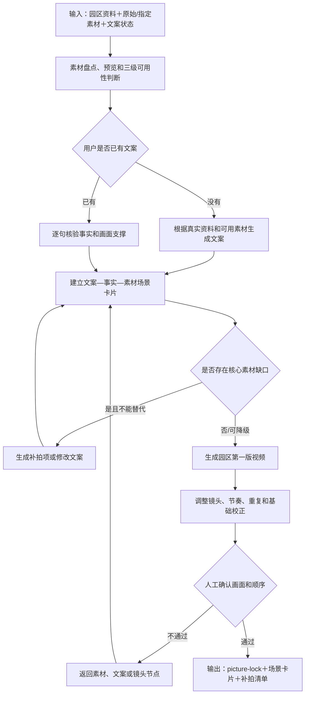

# 园区介绍视频子工作流设计

父流程：[视频生产总工作流](./2026-08-12-video-production-workflow-design.md)

状态：设计定稿；进入分期开发，待真实样片验证

## 1. 适用范围

用于真实园区、产业园、厂房、投资环境和招商推介类视频。只在任务路线为园区介绍时加载。

### 1.1 子工作流步骤链

```text
园区资料＋原始素材＋用户指定素材
→ 素材盘点、预览和可用性判断
→ 生成文案或核验用户文案
→ 建立“文案—事实—素材”场景卡片
→ 处理缺口、替代画面和补拍项
→ 生成园区第一版视频
→ 调整镜头、节奏、重复和基础画面校正
→ 用户确认画面与顺序
→ 输出 picture-lock 和场景卡片
```

文案、真实性或核心素材缺口返回文案/补拍节点；普通质量问题返回素材处理节点；通过画面锁定后交给字幕与声音包装子工作流。

### 1.2 子工作流流程图



## 2. 最小输入

- 园区名称、视频用途、平台、比例、目标时长和招商主题。
- 本地或 NAS 原始视频、图片及已有可用素材。
- 园区真实基础资料。
- 园区素材检查表；不存在时由系统根据素材盘点生成初稿。
- 用户已有文案，或明确选择由系统生成素材约束型文案。
- 用户指定希望优先使用的素材；没有指定也不影响系统推荐。
- 素材授权、不可展示内容和必须真实呈现对象。

## 3. 素材建库

1. 注册本机或 NAS 素材库，执行快速盘点和技术探测。
2. 对图片去重并判断清晰度、亮度、横竖版和推荐等级。
3. 对视频生成接触表，按需生成代理、场景片段和基础音频分析。
4. 对暗、偏色或 HDR 显示异常但内容仍可用的素材生成非破坏性基础校正建议，并确保代理预览和最终原片使用同一参数。
5. 识别门头、道路、厂房、设备、楼栋、铭牌、交通和配套。
6. 把素材映射到检查表的“一级分类＋点位/场景”。
7. 用户只确认低置信度分类、隐私、不适用项和关键缺口。

用户指定素材与系统候选使用同一评估标准。系统输出推荐使用、处理后可用、不建议使用或不可使用，并说明画幅、质量、文案匹配、归属、授权、声音、重复和节奏方面的依据。非阻断风险下用户坚持使用时记录人工决定；事实错误、无授权、严重隐私或文件损坏不得绕过。

第一阶段不计算综合推荐分数，也不预设统一质量阈值；只给出推荐理由、“可用 / 警告使用 / 不建议使用”和具体问题。普通低置信度素材允许警告使用，身份、园区归属和明确隐私风险必须人工确认。

“已整理可用”表示已经存在可直接进入分镜的图片或非破坏性片段时间码，不等于原始目录里有文件。

## 4. 两种文案入口

### 4.1 用户没有文案

系统基于园区资料、可剪素材、检查表、视频用途和已确认缺口生成素材可支撑的文案。不得先自由写卖点，再强行找不真实的画面。

未来可通过总工作流定义的 `script_request / script_result` 适配口调用视频脚本写作 Skill。适配器只接收结构化素材摘要和真实资料，输出仍需用户确认；Skill 不可用时回退到当前人工/通用生成方式。该能力属于后续待办，不阻塞 P0—P2。

### 4.2 用户已有文案

逐句执行“文案—事实—素材支撑检查”：

| 检查结果 | 处理方式 |
| --- | --- |
| 事实正确且有直接素材 | 保留原句并匹配 |
| 事实正确且有合法替代 | 用户确认替代方式后保留或轻改 |
| 事实正确但无画面支撑 | 改写为现有素材可表达内容，或形成补拍项 |
| 缺乏依据、夸大或存在时效风险 | 要求补资料、修改或删除 |
| 核心卖点必须保留但无合法替代 | 标记阻断，不使用虚假画面 |

输出逐句映射：旁白、事实依据、所需场景、实际素材、支撑状态和处理决定。

## 5. 场景卡片与第一版视频

每张场景卡片记录：

- 旁白文本和时间。
- 实际使用的 `asset_id / segment_id`。
- 素材所属园区、真实性、授权和来源。
- 画面类型、进入/退出时间、原素材声音策略。
- 素材来源类型：用户指定、系统推荐、长期素材库或缺口替代；同时记录系统建议和最终决定。
- 替代方案、置信度和用户确认状态。

先生成只关注内容结构的第一版视频，检查开头、信息顺序、画面匹配、总时长、重复素材、镜头长度和转场。画面锁定后再进入字幕与声音包装。

## 6. 缺口与补拍

缺口分为：

- 阻断型：核心事实或对象必须真实呈现，当前无素材且不能合法替代。
- 可降级型：可使用同一对象的图片、地图、参数卡或相邻场景。
- 可选型：不影响核心叙事，可直接省略。

无法合法替代的核心缺口形成补拍清单，并回写检查表。通用或 AI 素材不得冒充真实园区。

## 7. 完成标准

- 文案中的关键事实均有依据和画面处理决定。
- 所用真实素材的园区归属和授权状态明确。
- 第一版视频不存在明显错配、同源连续重复和无理由长镜头。
- 用户已确认画面与顺序，方可进入字幕、声音和包装子工作流。
