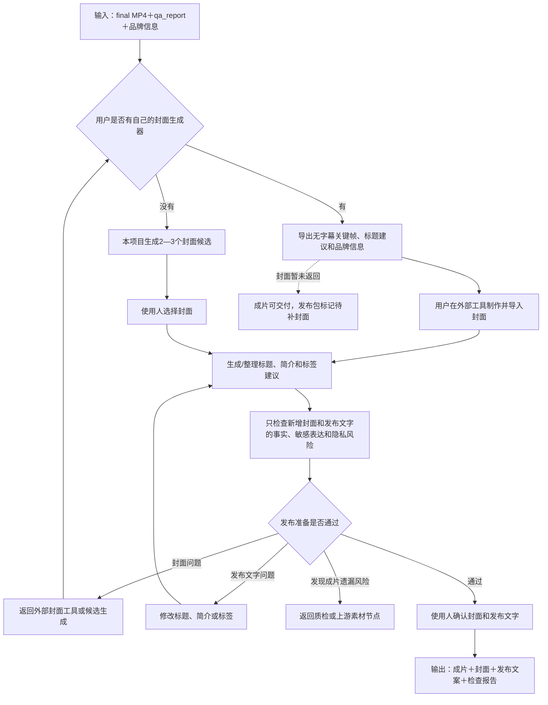

# 发布准备与合规检查子工作流设计

父流程：[视频生产总工作流](./2026-08-12-video-production-workflow-design.md)

前置流程：[质检、审片与交付子工作流](./2026-08-13-quality-review-delivery-subworkflow-design.md)

状态：设计定稿；进入分期开发，待 P2 实施和真实发布包验证

## 1. 目标与边界

本子工作流在候选成片通过自动质检、使用人完整观看并确认后加载，负责把成片整理为可直接人工发布的视频包。

当前同一份 9:16 成片直接用于视频号、抖音和小红书，不为三个平台分别重新剪辑，也不自动登录、上传或发布。

本子工作流只回答“已经制作合格的视频及新增发布内容是否适合公开发布”。它直接复用 `qa_report`，不重复检查黑帧、冻结帧、字幕时间、BGM响度、镜头重复和基础调色等成片质量项目。

### 1.1 子工作流步骤链

```text
读取 final MP4 和 qa_report
→ 判断用户是否使用自己的封面生成器
→ 准备外部封面素材包或生成 2—3 个封面候选
→ 生成标题、简介和标签建议
→ 只检查新增封面与发布文字的敏感表达、事实和隐私风险
→ 使用人确认封面与发布文字
→ 输出发布文件包
```

封面或发布文字有问题时只返回对应节点；只有发现成片本身遗漏风险时才返回质检或上游素材节点。

### 1.2 子工作流流程图



## 2. 输入

- 已通过完整审片的最终 MP4。
- 已确认文案、标题方向、品牌资产和 `qa_report`。
- 本次使用的素材、字幕、声音和包装依赖快照。
- 需要突出的人物、项目、城市、数字、政策或核心卖点。

## 3. 封面准备

先询问用户是否使用自己的封面生成器：

- 用户有自己的封面生成器：本项目不重复生成封面，只导出无字幕候选关键帧、标题建议、品牌信息和最终成片，供用户在自己的工具中制作。
- 用户没有自己的封面生成器：本项目从以下方式生成 2—3 个封面候选。

1. 从成片中选择清晰、主体明确且没有字幕残影的关键帧。
2. 使用真实图片或关键帧叠加简短标题和品牌元素。
3. 当画面不能表达核心信息时，使用已批准的品牌封面模板。

封面检查：

- 标题简短、无错字，手机缩略图尺寸仍可读。
- 人脸、项目主体、数字和品牌标识没有被裁切或遮挡。
- 不使用与视频内容无关或会造成事实误导的画面。
- 不堆叠过多花字、贴纸和颜色；标题是唯一主要视觉重点。

外部封面完成后，只检查错字、裁切、事实、敏感表达和新增隐私风险；不重复执行整条视频质检。使用人选择或导入最终封面，保存为 `publish_plan.cover`。外部封面尚未返回时，视频成片仍可交付，但发布包标记为“待补封面”。

## 4. 发布文字准备

基于已确认文案生成：

- 1 个主标题和 2—3 个备选标题。
- 一段简短发布简介。
- 少量相关话题或标签建议。

生成内容不得添加文案和来源资料中没有的政策、项目、企业、金额、排名或承诺。三个平台共用一套内容即可，使用人发布时可以自行微调。

## 5. 发布前检查

### 5.1 内容与敏感表达

- 检查错字、病句、夸大承诺、绝对化表达和容易产生误解的标题。
- 项目、城市、企业、政策、税务、金额、日期和排名继续沿用业务子工作流的事实边界。
- 敏感词检查只提供风险提示和上下文说明，不把单纯命中词表等同于违规。

### 5.2 隐私与素材风险

- 读取 `qa_report` 已确认的隐私和素材结果，不重复扫描或询问。
- 只检查封面截帧、外部封面、标题和简介是否新增或放大了人脸、车牌、手机号、二维码、内部信息等风险。
- 明确隐私风险默认返回画面裁切、打码、静音或素材替换节点。
- 团队绝大多数资产已有版权，发布前只检查是否存在来源不明、明确禁止商用或误用第三方资产的醒目风险，不建设复杂版权审批流。

### 5.3 技术检查

- 读取 `qa_report` 中 MP4 播放、比例、分辨率、编码和音轨结论，不重复执行同一检查；只有文件在交付后发生变化时才重新核验。
- 封面尺寸和格式可用。
- 主口播清楚，BGM没有压过人声。
- 发布文件名使用可识别的任务名和版本，不覆盖历史正式成片。

## 6. 输出发布包

```text
deliverables/publish/<task-id>/
├─ video-final-v1.mp4
├─ cover-final.jpg
├─ publish-copy.md
├─ publish-check.json
└─ qa-report.md
```

`publish-copy.md` 保存主标题、备选标题、简介和标签建议；`publish-check.json` 保存检查结果、警告、人工决定和实际使用的规则版本。

## 7. 返回节点

| 问题 | 返回节点 |
| --- | --- |
| 成片错字、字幕或声音问题 | 字幕声音包装或质检 |
| 事实、敏感表达或夸大问题 | 文案核验 |
| 隐私、素材误用或画面不当 | 素材选择、打码或画面调整 |
| 封面不合适 | 封面候选生成 |
| 文件编码或损坏 | 最终渲染 |

只重跑受影响环节，其他已经确认的素材分析、镜头、配音和包装不重做。

## 8. 完成标准

- 使用人已选择/导入封面并确认发布文字，或明确将使用自己的封面生成器且发布包已标记待补封面。
- 敏感表达、事实、隐私和明显素材风险均已处理或记录人工决定。
- 成片、封面、发布文字、检查结果和 QA 报告齐全。
- 同一发布包可以人工上传到视频号、抖音和小红书。
- 不把“发布准备完成”描述为“已经成功发布”。
