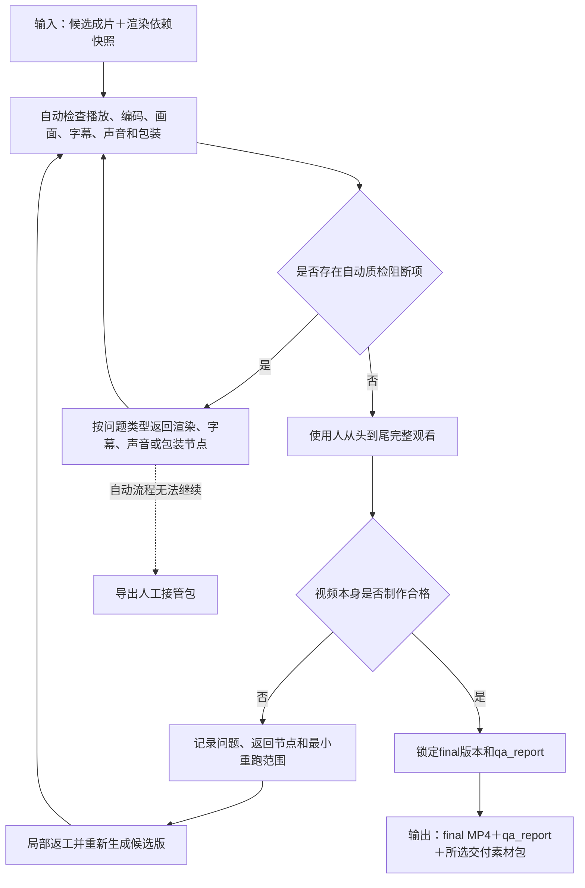

# 质检、审片与交付子工作流设计

父流程：[视频生产总工作流](./2026-08-12-video-production-workflow-design.md)

状态：设计定稿；进入分期开发，待 P2 实施和真实样片验证

## 1. 适用阶段

本子工作流在生成第一版视频、画面锁定后的候选版和正式交付前分别调用。它不负责决定业务文案和素材事实，只负责门禁、问题分类、返回节点、版本和交付完整性。

本子工作流只回答“视频本身是否制作合格”，不负责生成封面、发布标题、简介、标签或重新执行发布合规审查；这些由发布准备子工作流读取 `qa_report` 后处理。

### 1.1 子工作流步骤链

```text
读取候选成片和渲染依赖快照
→ 自动检查播放、编码、画面、字幕、声音和包装
→ 使用人从头到尾完整观看
→ 按问题类型生成 qa_report 和返回节点
→ 只重跑受影响环节并复检
→ 使用人确认视频本身可发布
→ 输出 final MP4、qa_report 和交付素材包
```

进入本环节前已经确认的事实、隐私和素材决定只核对依赖是否一致，不重复询问；只有成片中新出现、此前未发现或因裁切/包装放大的风险才重新提示。

### 1.2 子工作流流程图



## 2. 第一版检查

第一版只关注：

- 开头是否快速进入主题。
- 信息顺序是否清晰。
- 画面与旁白是否匹配。
- 是否存在同源连续重复、无理由长镜头和突兀切换。
- 总时长和数字人露出比例是否合理。

第一版不要求完整字幕、最终 BGM、音效和品牌包装。

### 2.1 镜头与重复的试片基线

- 开头钩子约 0.8—1.5 秒发生一次有效视觉变化。
- 普通 B-roll 通常约 1.5—2.5 秒。
- 重点空间展示可放宽到约 2.5—3.5 秒。
- 地图、政策截图和数据卡按实际阅读时间决定。
- 普通 B-roll 连续超过 3.5 秒预警，超过 5 秒必须有明确理由。
- 同一原素材即使切成不同片段，也按同源素材检查连续和高频重复。

以上仅为首批试片基线，必须根据真实审片反馈调整，不提前固化为永久参数。

### 2.2 转场连贯性

优先通过换镜头、调整切点和插入过渡镜头解决生硬问题，不堆叠特效。检查语义连续、景别变化、主体位置、运镜方向、明暗色温和句内切换。

语义和动作连续时优先自然硬切；时间或空间变化时可短叠化；跨度较大时优先插入门头、道路、全景、地图等过渡画面。

## 3. 画面锁定门禁

用户确认所用画面、顺序和主要时长后，记录 `picture-lock-v1`。锁定后如再修改素材或文案，系统必须说明会重跑哪些字幕、声音、包装和质检步骤。

## 4. 自动质检

候选成片至少检查：

- 文件可播放、时长、比例、分辨率、帧率和编码。
- 黑帧、冻结帧、异常静音、削波和明显音量突跳。
- 字幕越界、断句、错字、遮挡和显示时间。
- 人声、同期声和 BGM 的优先级。
- 重复镜头、长镜头和裁切风险。
- 素材缺失、NAS离线、指纹变化和渲染依赖不一致。
- 真实对象、政策截图、数据和来源标记是否符合业务子工作流要求。
- AI音色、BGM、音效、字幕模板、文字卡、贴纸、花字和品牌资产是否与 `packaging_plan` 一致，来源、授权和版本是否可追溯。
- 贴纸和花字是否遮挡主体、字幕或关键画面，是否同时堆叠过多，网络下载资产是否具有商业使用权限。
- 成片中新出现、此前未发现或因裁切/包装放大的人脸、车牌、屏幕、文件、工牌、二维码、联系方式和私人谈话风险。
- 基础提亮、白平衡和色彩转换是否同时正确应用于代理预览和最终原片。

自动检查只能发现可计算风险，不能代替完整人工观看。

## 5. 完整审片与问题路由

人工必须从头到尾观看候选成片。意见分类后返回对应节点：

| 问题类型 | 返回节点 |
| --- | --- |
| 文案、事实、错读 | 文案核验或数字人重制 |
| 素材错配、真实性、授权 | 素材选择和场景卡片 |
| 节奏、顺序、重复、转场 | 第一版和画面调整 |
| 字幕断句、累积、样式 | 字幕规划与包装 |
| 人声、原声、杂音、BGM | 声音策略与混音 |
| LOGO、标题、CTA、颜色 | 视觉包装 |
| 编码、黑帧、静音、文件损坏 | 渲染和技术质检 |

## 6. 版本与依赖快照

```text
rough-v1
rough-v2
picture-lock-v1
candidate-v1
candidate-v2
final-v1
```

每次候选和正式渲染保存文案、分镜、素材 ID、素材指纹、时间码、字幕计划、声音策略和包装配置。不得覆盖历史版本。

文案修改只重跑受影响依赖：错字更新字幕；单句修改更新该句配音、字幕、镜头和后续时间对齐；增删段落才重排受影响位置后的时间线。最终 MP4 可能需要全片重渲染，但不重新扫描素材库或重做无关分析。

新任务使用最新规则，原任务继续使用锁定的规则和资产版本；升级旧任务前必须显示影响范围。

## 7. 交付

“只要成片”至少交付：

- 最终 MP4。
- 成片检查报告。

“成片＋后续可编辑文件”当前交付可编辑素材包：

- 最终 MP4 和不带字幕包装的基础视频。
- 分轨人声、BGM和必要音效。
- SRT 字幕；如使用累积 ASS 效果，同时提供 ASS 和纯文本字幕说明。
- 实际使用的视频片段、图片或原片时间码清单。
- 场景顺序、素材来源、字体、颜色、LOGO、标题和 CTA 说明。

该素材包可导入剪映继续加工，但不等于剪映原生多轨工程。未验证前不得承诺原生工程。

自动流程无法继续但已完成选材、字幕或音频时，导出最小人工接管包：已确认文案、镜头顺序、素材路径及原片时间码、配音、字幕、BGM/音效、失败环节和待人工完成事项。这样可以转入剪映继续，不必从原始素材重新开始。

## 8. 归档与反馈回写

- 记录素材使用次数、拒绝原因和同源重复情况。
- 回写低质量素材、长期缺口、临时替代和补拍优先级。
- 保存成片、质检报告、分镜、字幕、声音策略和任务状态。
- 审片意见按结构、素材、节奏、字幕、声音、转场、包装和事实分类。
- 只有经过多条真实样片稳定验证的规则，才晋升为全局出片方案。

## 9. 参考样片与出片方案

没有 Peter 认可的参考样片时，不把历史视频直接定义为模板，也不因此停止底层能力建设。首批试片逐条记录具体问题，再从稳定认可结果中沉淀内容结构、镜头比例、节奏、字幕、声音、包装和导出预设。

“出片方案”是可复用规则集合，不是机械复制某条旧视频。

## 10. 完成标准

- 自动质检无阻断项。
- 用户已完整观看候选成片并确认。
- 最终文件、报告和所选交付包完整。
- 主口播在手机外放和普通耳机中清楚，BGM没有压过人声。
- 包装方案已经由使用人确认，密度没有遮挡主体、字幕或关键信息。
- 正式版本依赖快照可以追溯。
- 临时替代、未解决缺口和后续补拍项已明确记录。
