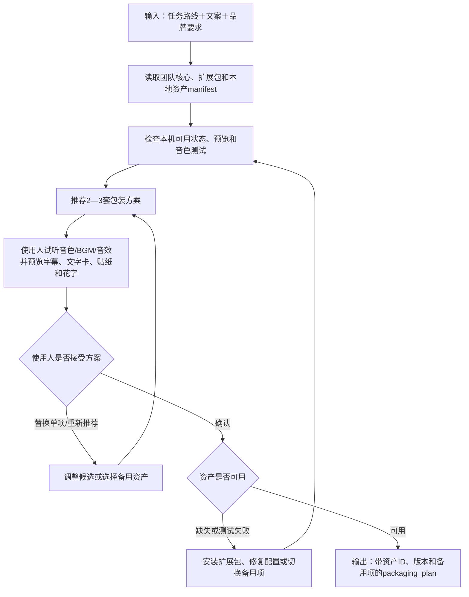

# 公共包装资产与AI音色库子工作流设计

父流程：[视频生产总工作流](./2026-08-12-video-production-workflow-design.md)

状态：设计定稿；进入分期开发，待 P1/P2 实施和真实样片验证

## 1. 目标与边界

让普通办公电脑上的同事 clone 团队私有 GitHub 仓库后，能立即知道有哪些AI音色、BGM、音效、字幕模板、文字信息卡、贴纸、花字和品牌资产，并能试听、预览、接受系统推荐或使用本地扩充资产。

核心小资产随仓库分发；较大扩展包通过 GitHub Release 安装；密钥、个人声纹、未授权资产和大型模型权重不进入主仓库。

### 1.1 子工作流步骤链

```text
读取团队核心资产、扩展包和本地资产 manifest
→ 检查本机可用状态和预览
→ 根据任务展示 2—3 套包装方案
→ 使用人试听音色/BGM/音效并预览字幕、文字卡、贴纸和花字
→ 使用人整套采用或替换单项
→ 确认包装方案
→ 输出带资产 ID、版本和备用项的 packaging_plan
```

缺少资产时提示安装或选择备用项；首次使用新音色先生成测试音；包装方案无论是否命中默认模板都必须由使用人确认。

### 1.2 子工作流流程图



## 2. 资产分类

| 资产库 | 内容 | 默认用途 |
| --- | --- | --- |
| AI音色库 | 云端音色ID、名称、试听、语言、风格、参数、授权和备用音色 | 主旁白和数字人外配音 |
| BGM库 | 音乐文件或扩展包、风格、节奏、授权、循环点和响度 | 背景音乐 |
| 音效库 | 标题进入、数据弹出、页面切换、提示等短音效 | 重点提示和轻量转场 |
| 字幕模板库 | 普通、累积、金句、数据重点和政策提示 | 字幕包装 |
| 文字信息卡库 | 标题卡、金句卡、数据卡、政策卡、区位卡、参数卡和风险提示卡 | 承载一组结构化信息 |
| 贴纸库 | 箭头、灯泡、点赞、定位、金币、爆炸框等静态或动画贴纸 | 装饰画面、强化语气和指向重点 |
| 花字模板库 | 立体字、渐变字、描边字、放大字、弹跳字和滑入字 | 强调关键词或短句 |
| 品牌资产库 | LOGO、水印、字体、品牌色、片头、片尾和CTA | 品牌一致性 |

AI音色、BGM和音效分别管理，不混为一个“声音库”。

贴纸不等于文字信息卡：贴纸主要承担装饰、情绪和指向作用；文字卡承载需要阅读的完整信息。花字也不等于字幕：花字只强调少量关键词或短句，普通字幕仍负责完整口播。

## 3. 分发结构

```text
assets/                              # 随Git仓库，clone后可用
├─ manifests/
│  ├─ voice-profiles.json
│  ├─ bgm.json
│  ├─ sfx.json
│  ├─ subtitle-presets.json
│  ├─ visual-cards.json
│  ├─ stickers.json
│  └─ fancy-text-presets.json
├─ voice-profiles/{samples,pronunciation}/
├─ bgm-core/
├─ sfx-core/
├─ subtitle-presets/
├─ visual-cards/
├─ stickers/
├─ fancy-text-presets/
├─ fonts/
└─ brand/

asset-packs/                         # 一键安装，不进入普通Git历史
├─ voices/
├─ bgm/
├─ sfx/
├─ visual-cards/
├─ stickers/
└─ fancy-text-presets/

assets-local/                        # 每位用户自行扩充，Git忽略
├─ voice-profiles/
├─ bgm/
├─ sfx/
├─ subtitle-presets/
├─ visual-cards/
├─ stickers/
└─ fancy-text-presets/
```

加载优先级：用户本地资产 → 团队扩展包 → 仓库核心资产。相同 `asset_id` 的本地覆盖必须明确显示来源，不能静默替换团队资产。

## 4. 普通办公电脑的配音策略

默认使用云端AI配音服务，当前主路径为项目已接入的火山豆包TTS。仓库保存音色配置和短试听，不保存API密钥。

开源本地TTS只作为可选实验适配器，不承诺普通办公电脑 clone 后立即运行，也不作为生产阻断依赖。模型代码、权重、训练数据和参考声音分别审查许可证和授权。

音色配置示例：

```json
{
  "asset_id": "voice_park_female_01",
  "display_name": "园区专业女声",
  "provider": "volcengine",
  "provider_voice_id": "xxx",
  "suitable_for": ["园区介绍", "招商政策"],
  "styles": ["稳重", "专业"],
  "speed": 1.0,
  "sample": "voice-profiles/samples/park_female_01.mp3",
  "authorization": "team-approved",
  "fallback": "voice_neutral_female_01",
  "last_success_at": "2026-08-13T10:00:00+08:00",
  "last_output": "projects/task-001/inputs/voice/main.wav"
}
```

## 5. 同事如何知道有哪些资产

### 5.1 任务中的主动推荐

系统根据视频路线、发布平台、用途、文案和品牌预设，默认只展示3—5个合适候选，或2—3套包装方案：

```text
稳重招商型
专业女声＋大气轻科技BGM＋数据强调卡＋箭头贴纸＋轻提示音

城市资讯型
资讯男声＋城市节奏BGM＋地图卡＋关键词弹入花字＋快速提示音

财税专业型
沉稳女声＋低存在感BGM＋政策条款卡＋风险提示花字＋少量提示音
```

用户可以整套采用、替换单项、要求重新推荐，或选择不使用BGM/音效。

推荐不计算缺乏真实样本依据的综合分数，只展示匹配理由、可用状态和必要警告。包装方案即使命中团队默认模板，也必须由使用人查看预览并确认后才进入正式渲染。

### 5.2 本地可浏览资产目录

提供命令：

```powershell
npm run assets:catalog
```

生成并打开本地静态HTML目录，支持：

- 播放AI音色、BGM和音效试听。
- 查看字幕动画、文字卡、贴纸、花字、LOGO、水印和CTA预览。
- 按园区、城市、财税、稳重、科技、节奏和资产来源筛选。
- 查看授权、适用范围、本机可用状态和备用资产。
- 复制资产ID，并区分团队核心、团队扩展和本地资产。

不开发完整剪辑平台；目录由manifest生成，可离线浏览已安装资产。

### 5.3 统一预览要求

| 资产 | 预览 |
| --- | --- |
| AI音色 | 5—10秒统一试听文案 |
| BGM | 15—30秒试听片段及循环说明 |
| 音效 | 原音直接播放 |
| 字幕模板 | 短MP4、GIF或预渲染样例 |
| 文字特效卡 | PNG缩略图加短动画 |
| 贴纸 | 透明背景静态预览或GIF/WebP/MP4动画预览 |
| 花字模板 | 使用统一测试词生成的短动画预览 |
| 品牌资产 | PNG或综合样例 |

缺少预览或授权信息的资产可以作为待完善资产保存，但不能进入默认推荐。

## 6. 在生产流程中的位置

音色和其他包装资产采用分阶段确认：

1. 文案或配音前，推荐并确认AI音色；先合成3秒测试音频，验证当前账号有权限。
2. 第一版视频阶段可使用临时BGM或不加BGM，不投入最终包装。
3. 画面与顺序锁定后，推荐完整包装方案。
4. 用户试听BGM、音效并查看字幕、文字卡、贴纸和花字预览。
5. 确认 `packaging_plan` 后，进入字幕与声音包装子工作流。

## 7. clone与首次使用

```text
git clone
→ npm install
→ npm run doctor
→ npm run assets:validate
→ 浏览核心资产和试听
→ 配置本机.env中的云端TTS密钥
→ 合成3秒测试音频
→ 正式使用
```

`doctor`检查FFmpeg、Node/Python、字体、manifest、核心资产、云端TTS配置和测试合成。无TTS密钥时，仍可浏览资产、整理素材和剪辑；只在正式配音时阻塞。

## 8. 扩展资产包

大体量BGM、音效和预览以版本化ZIP发布到团队私有GitHub Release，不使用绝对路径。提供：

```powershell
npm run assets:check
npm run assets:setup
```

安装器读取版本、下载地址、SHA-256、解压目录和许可证摘要。下载失败不破坏已有资产；校验失败不得启用该包。

## 9. 用户本地扩充

用户把资产放入 `assets-local/` 后运行：

```powershell
npm run assets:scan
npm run assets:validate
```

检查文件损坏、格式、重复、响度、循环、预览、授权、比例、资产ID冲突和本机可用性。验证结果写入本地manifest，不自动上传GitHub。

稳定资产可以申请晋升团队核心库或扩展包；晋升前必须补齐来源、授权、预览、标签和质量验证。

### 9.1 网络下载贴纸和花字素材

允许同事在本地添加网络下载的通用贴纸、纹理、字体或花字动画素材，但必须先进入：

```text
assets-local/stickers/inbox/
assets-local/fancy-text-presets/inbox/
```

扫描后尽量记录来源网址、作者或平台、下载日期、授权说明、是否允许商业使用和团队再分发。团队绝大多数资产已有版权，第一阶段不建设复杂授权审批系统；来源不明时才提示补充或替换。授权状态统一为：

| 状态 | 使用范围 |
| --- | --- |
| `commercial-approved` | 可用于正式商业视频 |
| `internal-only` | 只用于内部测试和预览 |
| `unknown` | 授权不明，不进入正式成片 |
| `restricted` | 按来源注明的范围使用 |
| `prohibited` | 禁止使用 |

网络可下载不等于可商业使用。授权不明的素材默认只用于本地预览；正式使用时给出醒目警告，由使用人确认其已经具有使用权或替换素材。明确标记为禁止商用或来源明确侵权的资产必须阻断。

贴纸扫描额外检查透明背景、静态/动画格式、尺寸、循环、持续时间和重复。花字模板额外检查字体、纹理、配色、描边、阴影、立体效果、进入/停留/退出动画、目标比例和安全区。

首轮花字效果限定为放大弹入、轻微弹跳、左右滑入、渐变描边、立体阴影和关键词颜色脉冲；复杂粒子、重3D旋转和高成本动画不进入首轮。

## 10. 授权与安全

- 私有仓库不等于自动获得再分发权。
- 每项资产记录来源、许可证、商业使用、修改和团队再分发条件。
- AI音色不得使用未经授权的员工、客户、公众人物或第三方声纹。
- 网络贴纸、字体、纹理和花字动画同样必须核验商业使用和再分发条件。
- API Key、Token、Cookie和客户参考声纹不进入Git。
- 开源项目分别核对代码、模型权重、训练数据、音色和依赖许可证。
- 授权不明确的资产不进入默认推荐；正式使用时必须由使用人确认已经具有使用权。明确禁止商用或来源明确侵权的资产不得进入正式交付。

外部文件只做最小安全隔离：新下载素材先进入 `assets-local/*/inbox/`；检查扩展名与真实格式、文件大小、能否正常解码和是否损坏后再启用。压缩包不自动批量展开，素材文件不作为程序执行，伪装格式和异常文件移入隔离区并警告。

资产生命周期保持轻量：`available / paused / missing`。暂停或丢失后不再进入新任务推荐；未完成任务已经引用时提示更换，已发布视频不自动追溯。删除文件前列出仍在使用该资产的未完成任务，不建设自动召回、审批流或历史成片级联替换。

## 11. 当前能力差距

- 当前TTS脚本已接入火山豆包，但只从 `.env` 读取单个 `TTS_VOICE_TYPE`，尚未读取音色库。
- `.env.example` 尚未完整列出TTS配置。
- 尚无统一资产manifest、资产浏览目录、扩展包安装器、本地扩充扫描器、贴纸库和花字模板库。
- 现有基础BGM、标题卡和字幕能力分散在渲染脚本中，尚未组成可浏览、可推荐的包装方案。

以上进入P1/P2实施，不在设计阶段描述为已可用。

## 12. 验收

- 新同事clone后可离线浏览核心资产名称、标签和预览。
- 配置云端密钥后可按音色ID完成3秒测试合成和正式配音。
- 任务能推荐2—3套包装方案并允许单项替换。
- 任务能区分字幕、文字卡、贴纸和花字，并避免同屏过度堆叠。
- 本地资产可以扫描、验证、使用且不污染团队仓库。
- 网络下载贴纸和花字素材在授权不明时不进入默认推荐；使用人确认已有使用权后可以进入正式成片，明确禁止商用的素材不能使用。
- 扩展包可校验安装，失败时不影响核心资产。
- 所有正式使用资产均能追溯来源、授权和版本。
- AI音色记录服务平台、音色ID、参数、试听、最近成功时间和实际输出，便于平台音色变化后追溯。
