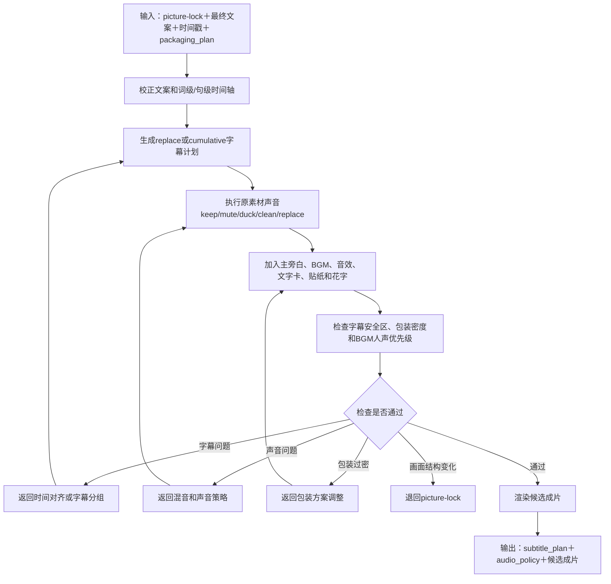

# 字幕与声音包装子工作流设计

父流程：[视频生产总工作流](./2026-08-12-video-production-workflow-design.md)

资产来源：[公共包装资产与AI音色库子工作流](./2026-08-13-shared-packaging-assets-voice-library-subworkflow-design.md)

状态：设计定稿；进入分期开发，待 P2 实施和真实样片验证

## 1. 进入条件

- 最终文案或最终配音文本已确认。
- 词级或句级时间戳已完成校正。
- 第一版视频已通过“画面与顺序确认”门禁。
- 场景卡片已为每段原素材指定初步 `audio_policy`。
- AI音色已在正式配音前确认，或明确沿用数字人/真人原声。
- 画面锁定后，BGM、音效、字幕模板、文字卡、贴纸和花字已形成待确认或已确认的 `packaging_plan`。

画面仍频繁变化时不进行最终字幕和混音，避免重复返工。

### 1.1 子工作流步骤链

```text
读取 picture-lock、最终文案、时间戳和 packaging_plan
→ 校正文案与词级/句级时间轴
→ 生成 replace 或 cumulative 字幕计划
→ 执行原素材声音 keep/mute/duck/clean/replace 决策
→ 加入主旁白、BGM、音效、文字卡、贴纸和花字
→ 检查包装密度、字幕安全区和 BGM 人声优先级
→ 渲染候选成片
→ 输出 subtitle_plan、audio_policy 和候选成片
```

字幕错字返回时间对齐或字幕规划；声音问题返回混音；包装过密返回包装方案调整。画面结构变化则退回 picture-lock，不在本环节强行修补。

### 1.2 子工作流流程图



## 2. 原始素材声音识别

原始视频中的音轨可能包含拍摄者说话、被拍对象说话、同期环境声、风声、车辆声、设备声、音乐、静音或杂音。系统先识别和分类，再做处理决定。

分析阶段：

1. 检查是否存在音轨、声道、采样率和时长。
2. 使用 VAD 标记人声区间。
3. 对人声区间生成粗转写，帮助判断内容和隐私风险。
4. 检测明显静音、削波、音量突跳和持续底噪。
5. 保存人声区间、粗转写、异常标签、置信度和分析版本。

第一阶段不要求精确识别所有噪声类型，也不默认识别具体说话人身份。复杂环境、多人重叠、方言和强噪声下结果必须允许人工确认。

## 3. 原素材声音决策

每个场景卡片使用一种或多种策略：

| `audio_policy` | 适用情况 |
| --- | --- |
| `keep` | 同期声对现场感和信息表达有价值 |
| `mute` | 拍摄者闲聊、隐私、无关说话或明显干扰 |
| `duck` | 环境声可保留，但必须低于主旁白 |
| `clean` | 有价值的人声或环境声需要基础降噪、均衡或限幅 |
| `replace` | 原声不可用，由主旁白、BGM或音效替代 |

识别发生在素材资产层；业务上是否保留由项目或数字人场景卡片决定；真正处理在本子工作流执行。

## 4. 主声音优先级

声音优先级为：

```text
主口播/主旁白 > 必要同期声 > 提示音效 > BGM > 非必要环境声
```

处理顺序：

1. 校正主声音时长和错读。
2. 处理必要同期声和原素材杂音。
3. 统一人声响度并检查削波。
4. 加入 BGM 和必要音效。
5. 对有人声区间执行 BGM 和环境声压低。
6. 使用手机扬声器进行最终试听。

具体响度和 ducking 参数必须通过真实样片确定，不在验证前固化为唯一数值。

第一阶段的业务硬标准是：在手机外放和普通耳机中，主口播必须始终清楚，BGM不得压过人声。当前项目已有 BGM 约 `-19 dB` 的经验值可作为首批试片起点；检测到人声时继续自动压低，无人声片段可适度恢复。底层保存响度数据，但正式阈值等待真实样片校准。

## 5. 包装资产使用

- AI音色从音色库按资产ID读取，不再依赖用户记忆服务商内部ID。
- BGM和音效从独立资产库选择，记录授权、版本和实际使用区间。
- 字幕模板和文字特效卡从公共或本地资产库读取，按视频比例和安全区渲染。
- 贴纸用于装饰、情绪和指向，不承担完整信息；花字只强调关键词或短句，不替代普通字幕和文字卡。
- 默认由系统推荐完整包装方案；用户可整套采用、替换单项或禁用BGM/音效。
- 缺少资产、授权不清或本机不可用时，使用已声明的备用资产，不静默替换。
- 包装方案必须由使用人确认后才进入正式渲染，团队默认模板也不例外。

### 5.1 包装密度试片基线

60 秒标准视频先采用以下基线，待真实审片反馈调整：

- 花字 3—6 处，每次只突出一个短词、地名或数字。
- 文字信息卡 2—4 处，每次约 2—4 秒，并保证手机端可读。
- 贴纸 2—5 处，只用于情绪、指向或丰富空画面。
- 音效 3—8 处，只匹配关键动作、重点词或信息卡进入。
- 转场优先自然硬切，只有时间/空间变化或镜头衔接需要时才使用短叠化等轻量效果。
- 同一时刻除普通字幕外，最多再出现一个主要强调元素；3 秒内通常不连续触发多个强动画。
- 严肃政策和财税内容降低密度，宣传和节奏型内容可以适度提高。

以上是首批试片基线，不是永久硬阈值。无论密度高低，均不得遮挡人物脸部、项目主体、字幕安全区或关键画面。

## 6. 累积字幕模式

用户目标：几句话或短语出现在同一屏，按口播顺序一句一句增加；已出现内容保留，最后呈现完整语义句，然后整体退场。

示例：

```text
阶段1：这里不仅有标准厂房
阶段2：这里不仅有标准厂房
       还有成熟的产业配套
阶段3：这里不仅有标准厂房
       还有成熟的产业配套
       和高效的企业服务
```

该模式命名为 `cumulative`。同时保留现有短句轮换模式 `replace`，不同视频或不同段落可以选择。

## 7. 字幕生成链

```text
最终文案
→ 词级时间戳
→ 用原文校正识别文本
→ 划分完整语义句
→ 在语义句内划分显示短语
→ 为每个短语定位开始时间
→ 生成逐步累积的 ASS 事件
→ 检查行数、字数、安全区和阅读时长
→ 烧录并在手机尺寸审看
```

累积字幕的实现应由字幕规划器生成多个时间连续的 ASS Dialogue 事件；每次事件包含此前已出现的短语。第一阶段不依赖复杂逐字卡拉OK效果。

## 8. 分组与换屏规则

- 先按句号、问号、叹号和完整语义划分大组，不只按字符数切分。
- 大组内再按逗号、分号、语义停顿和词级时间戳划分短语。
- 不切断数字、量词、项目名、城市名、企业名、政策名、税务术语和重点词。
- 同屏达到最大行数、最大字数或字幕安全区时，提前在完整短语边界换屏。
- 最后一个短语出现后，完整语义句至少保留到该句口播结束；额外停留时间通过样片验证。
- 金句、标题卡、政策截图等特殊段落可覆盖默认模式。
- 字幕、花字、贴纸和文字卡同屏时按“主要信息 > 关键词强调 > 装饰”控制层级；画面过满时优先移除贴纸和非必要花字。

## 9. 样式与可读性

- 默认思源粗宋，普通字幕白色，重点词橘黄。
- 字幕位置避开人物脸部、平台按钮和关键信息。
- 累积内容增加时保持固定锚点，避免整块字幕上下跳动。
- 每种比例分别验证安全区；不得直接把 9:16 参数套用到 16:9。
- 最终字幕文本以确认文案为准，不使用 Whisper 错字。

## 10. 当前代码差距

- `transcribe.py` 已支持数字人口播的 VAD 和词级时间戳，但未对原始素材库批量生成声音分析记录。
- `make-ass.ts` 当前为短 cue 轮换显示，只支持 `replace` 类行为，尚未实现完整语义句分组和 `cumulative` 模式。
- 现有渲染脚本可以处理基础音轨和 BGM，但尚未形成场景级原声策略、系统化噪声检测和统一响度流程。
- 尚未接入统一AI音色、BGM、音效、字幕模板、文字卡、贴纸和花字manifest，也没有包装方案选择界面或本地资产目录。

以上能力进入 P1/P2，不在设计阶段假定已经可用。

## 11. 验收

- 含拍摄者说话和明显杂音的测试素材能生成可审查的声音分析摘要。
- 用户可以对每个场景选择保留、静音、压低、清理或替换。
- 累积字幕按短语时间逐步出现，最后形成完整语义句。
- 字幕不越界、不遮挡主体，不切断关键术语，并通过手机尺寸审看。
- BGM和原素材声音不压过主口播，不出现明显削波和音量突跳。
