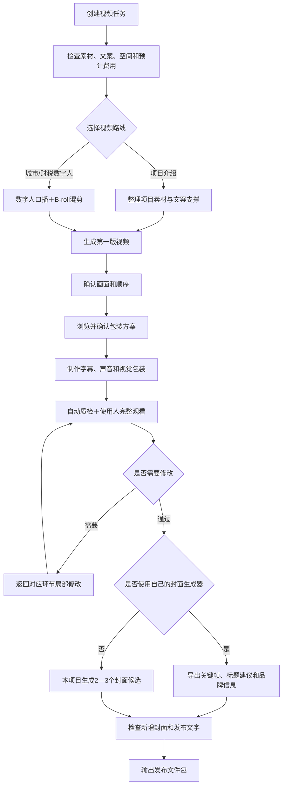

# 视频生产工作流用户使用手册

> 本文件是 2026-08-13 的目标流程设计记录。当前普通同事请使用 [剪辑工作台同事操作手册](./cutroom-user-guide.md)，不要把本页尚未实施的目标能力当作现行功能。

适用对象：使用本项目制作项目介绍、城市矩阵数字人和财税数字人短视频的普通团队成员。

文档状态：这是设计定稿后的目标使用流程，不是已发布的独立工具操作手册。`main` 仅为 2026-08-21 安全基线；当前 P1/P2 实现仍在 `codex/p1-p2-recovery`，尚未合并。尚未通过的能力须由 Codex 或 WorkBuddy 结合当前可用脚本和人工步骤协助完成。

当前门禁：P0 的 10GB 技术验收与 WorkBuddy 实操已通过，但普通同事电脑、实际移动硬盘和真实长路径/权限环境仍待现场复核；P1 核心能力完成本机技术验证，但模块 14 样片、普通同事使用和真实操作时长未完成；P2 数字人首版自动 QA 已通过但 Peter 人工审片未通过，v2 成片、审批、发布包和项目路线验收均不存在；P3 原型继续暂停扩展，直到两条真实路线通过。

未来计划接入视频脚本写作 Skill：项目无文案任务可以根据真实资料和素材摘要生成文案初稿；数字人文案只能在生成禅镜 MP4 之前完成。所有 Skill 文案仍需人工确认，当前阶段继续使用用户文案或现有生成方式。

## 1. 你能用它完成什么

- 在 Agent 协助下整理本机或移动硬盘中 10GB 以上的视频和图片素材，不把原片上传给 Agent。
- 制作真实项目介绍视频。
- 把禅镜数字人口播与 B-roll、图片、地图、政策截图和信息卡混合剪辑。
- 生成字幕、AI配音、BGM、音效、文字卡、贴纸和花字包装。
- 完成成片质检、完整审片和发布准备。
- 输出最终 MP4；需要时还可以输出字幕、分轨声音、素材时间码和人工接管包。

## 2. 核心工作流



标准任务有四个人工确认点：文案锁定、画面和顺序锁定、包装方案确认、完整观看并确认可发布。遇到素材低置信度、隐私风险、输入缺失或技术异常时，系统会增加条件式确认。

## 3. 开始前准备

### 项目视频

- 项目名称、用途和目标时长范围。
- 本机或移动硬盘中的视频和图片。
- 项目基础资料和已有素材检查表；没有检查表时可以先生成初稿。
- 已有文案，或者明确由系统根据真实素材生成文案。
- 希望优先使用的素材，以及不能展示或必须真实展示的内容。

### 数字人＋B-roll视频

- 禅镜最终数字人 MP4。
- 禅镜实际使用的最终口播文案。
- 用户指定 B-roll；没有指定时可以从已登记素材库或允许来源推荐。
- 涉及城市、企业、政策、税务、金额、日期或排名时准备相应来源资料。

## 4. 创建任务时你会看到什么

目标流程的简明预计值格式如下；当前试用由 Agent 提供，不承诺已有独立界面：

```text
预计完成：约25—35分钟
预计新增磁盘：约1.8GB
预计API费用：约3—5元
预计人工确认：4次
```

项目分别记录：

- 人工操作时间：你实际选择、修改和审片的时间。
- 总完成时间：包含素材分析、配音和渲染等待的全部时间。

同一时间只剪辑一条视频。一个重任务运行时可以浏览素材或编辑另一条文案，但不要同时启动第二条视频的识别、代理生成或渲染。

## 5. 素材怎么处理

素材依次完成快速扫描、技术探测、按需预览和内容分析。你不会直接操作 SQLite、素材 ID 或代理文件。

系统给出的结论只有三类：

- 可用：没有发现明显问题。
- 警告使用：存在偏暗、抖动、匹配不充分等问题，但你可以决定使用。
- 不建议使用：损坏、严重模糊、严重隐私或明显事实错误等问题。

用户指定素材也会接受同样的检查。暗画面可以尝试非破坏性提亮；代理预览和最终原片使用同一组校正参数。

## 6. 数字人怎样与B-roll混剪

数字人口播负责主叙事和声音时间轴，系统按口播语义安排以下画面：

- 数字人全屏。
- B-roll 全屏覆盖，同时保留数字人口播声音。
- 数字人与 B-roll 画中画。
- 地图、政策截图、数据卡或文字信息卡覆盖。
- B-roll 结束后返回数字人。

第一版重点确认数字人露出比例、B-roll进入和退出时间、画面是否匹配文案、是否重复以及转场是否自然。

## 7. 包装方案怎么选

系统默认只展示 2—3 套相关方案，包括AI音色、BGM、音效、字幕、文字卡、贴纸和花字。你可以：

- 整套采用。
- 替换其中一项。
- 不使用BGM或音效。
- 要求重新推荐。

包装方案必须由你确认，默认模板也不会静默通过。普通字幕负责完整口播；花字只强调少量词语；文字卡承载完整信息；贴纸负责装饰和指向。BGM不得压过人声。

## 8. 质检、审片和发布检查的区别

- 质检与审片：判断视频本身是否制作合格，包括播放、画面、字幕、声音、节奏、包装和完整观看。
- 发布准备：直接读取质检报告，只处理封面、标题、简介、标签及其新增的敏感表达、事实和隐私风险。

已经在质检阶段确认的问题不会在发布阶段重复询问。只有封面截帧、外部封面或发布文字新增了风险时才提示。

## 9. 使用自己的封面生成器

如果你有自己的封面生成器，选择“使用外部封面工具”：

1. 本项目导出无字幕候选关键帧、标题建议、品牌信息和最终成片。
2. 你在自己的工具中制作封面。
3. 导入封面后，本项目只检查错字、裁切、事实、敏感表达和新增隐私风险。

如果暂时没有返回封面，视频成片仍可交付，发布包会标记“待补封面”。如果没有自己的封面工具，本项目生成 2—3 个候选供你选择。

## 10. 文案修改和返工

- 只改错字：更新字幕和最终渲染。
- 修改一句：更新该句配音、字幕、对应镜头和后续时间对齐。
- 增删一段：重新排列受影响位置之后的时间线。
- 修改整体结构：返回分镜及后续环节。

素材库不重新扫描，无关素材和已经确认的无关镜头不重做。最终完整 MP4 仍可能需要重新导出。

## 11. 中断、失败和人工接管

扫描、探测、分析和渲染都有独立状态。电脑重启或 Agent 中断后，只继续未完成阶段。

如果自动流程无法继续，可以导出人工接管包，包括：确认文案、镜头顺序、素材位置和原片时间码、配音、字幕、BGM/音效、失败环节和待办说明，然后在剪映中继续完成，不需要从10GB素材里重新选择。

## 12. 每周空间检查

系统每周提醒检查一次空间，磁盘剩余低于20%时立即提醒。自动清理只针对可重建的缩略图、代理、临时文件和失败渲染。原始素材、数据库、文案、人工确认、最终成片不会自动删除。

## 13. 最终会得到什么

标准发布包包括：

- 最终 MP4。
- 最终封面，或“待补外部封面”状态。
- 发布标题、简介和标签建议。
- 发布前检查结果和成片质检报告。

选择“成片＋后续可编辑文件”时，还可以得到基础视频、分轨人声/BGM/音效、SRT/ASS字幕、实际素材和原片时间码清单。它可以导入剪映继续加工，但当前不承诺剪映原生多轨工程。
